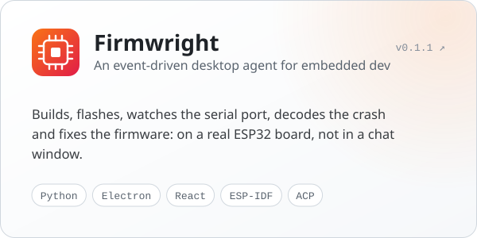
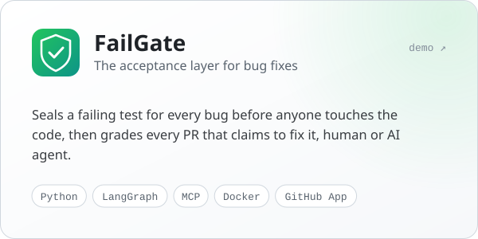

<picture>
  <source media="(prefers-color-scheme: dark)" srcset="assets/banner-dark.svg">
  
</picture>

 

### 👋 About me

I'm fascinated by **AI agents**: not just what a model says, but what happens when it is given tools, memory and a real environment, and has to *act*.
I like taking agents apart to see how they think, building my own loops from scratch, and pointing them at problems that push back: real hardware, real bugs, real codebases.

Every project I start ends up as the same question asked a different way: **how do we make agents that do real work, and how do we know they got it right?**

- 🔭 **Building** [Firmwright](https://github.com/san086041-glitch/firmwright): a desktop agent that puts a real ESP32 board inside the agent loop
- 🧪 **Exploring** context engineering, event-driven agents, planner / verifier loops, and agent evaluation
- 📖 **Reading** open-source agent harnesses to learn how others design their loops, tools and permissions
- 💬 **Ask me about** agent loops, tool design, MCP, or why your ESP32 keeps rebooting

 

### 🚀 Featured projects

<table>
  <tr>
    <td width="50%" valign="top">
      <a href="https://github.com/san086041-glitch/firmwright">
        <picture>
          <source media="(prefers-color-scheme: dark)" srcset="assets/card-firmwright-dark.svg">
          
        </picture>
      </a>
    </td>
    <td width="50%" valign="top">
      <a href="https://github.com/san086041-glitch/FailGate">
        <picture>
          <source media="(prefers-color-scheme: dark)" srcset="assets/card-failgate-dark.svg">
          
        </picture>
      </a>
    </td>
  </tr>
</table>

 

### 🧭 What I believe about agents

> 🔁 **The loop is the product.** The model is one piece; the context, tools, events and recovery around it decide what an agent can actually do.
>
> 🌍 **Give agents the world, not a screenshot of it.** Firmwright lets the agent flash the board and read the crash itself, instead of waiting for someone to paste a log.
>
> ✅ **Check, don't trust.** FailGate writes the exam before the fix exists, so no agent gets to grade its own homework.
>
> 📈 **Measure, then believe.** Every run leaves a trace, and every design layer can be switched off to see what it is really worth.

 

### 🛠️ Toolbox

  
  
  
  
  
  
  
  
  
  
  

 

<picture>
  <source media="(prefers-color-scheme: dark)" srcset="assets/footer-dark.svg">
  
</picture>
